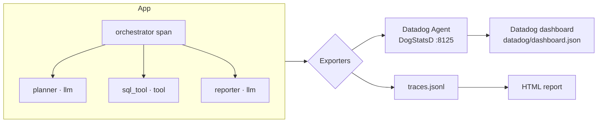

# LLM Observability Kit

A lightweight, dependency-free toolkit to **measure LLM apps and AI agents in production**: latency, tokens, estimated cost, errors and quality scores — exported to **Datadog** (DogStatsD), JSONL or the console, with a ready-to-import Datadog dashboard and an offline HTML report.

> Portfolio project inspired by defining agent/LLM metrics in Datadog for production AI systems. Generic, vendor-neutral code; no proprietary content.

## Why

Agentic systems fail in ways classic APM doesn't show: a planner that loops, a tool call that silently slows down, token usage that doubles after a prompt change, answers that drift away from the context. This kit makes each **agent step, LLM call and tool call a span**, grouped into one trace per run.



## Metrics

| Metric | Type | Tags |
|---|---|---|
| `llm.latency_ms` | distribution (p50/p95/p99) | span, kind, model, status, service |
| `llm.requests` / `llm.errors` | count | same |
| `llm.tokens.input` / `llm.tokens.output` | count | same |
| `llm.cost_usd` | count (estimated) | same |
| `llm.quality.<name>` | gauge (e.g. groundedness, refusal) | same |

## Usage

```python
from llmobs import Tracer, JsonlExporter, DatadogStatsdExporter
from llmobs.bedrock import instrument_bedrock
from llmobs.quality import groundedness
import boto3

tracer = Tracer(service="ia-analyzer", exporters=[DatadogStatsdExporter(), JsonlExporter()])
bedrock = instrument_bedrock(boto3.client("bedrock-runtime"), tracer)  # every converse() is traced

with tracer.span("orchestrator", kind="agent"):
    with tracer.span("reporter", kind="agent") as s:
        resp = bedrock.converse(modelId="...", messages=[...])
        answer = resp["output"]["message"]["content"][0]["text"]
        s.record_quality(groundedness=groundedness(answer, context))
```

Or decorate any function that returns usage fields:

```python
@observe("summarize", kind="llm")
def summarize(text): ...
```

## Quickstart (offline demo)

```bash
pip install -r requirements.txt
python examples/agent_demo.py           # simulated multi-agent runs -> traces.jsonl
python -m llmobs.report traces.jsonl    # summary table + report.html
pytest -q
```

Example summary:

```
              calls  p50_ms  p95_ms  error_rate  input_tokens  output_tokens  cost_usd
orchestrator     25    72.8   105.8        0.08             0              0   0.00000
planner          25    30.0    47.1        0.08         11924           3427   0.02906
reporter         23    40.3    52.1        0.00         23333           6478   0.05572
sql_tool         23    10.9    20.7        0.00             0              0   0.00000
```

## Datadog

1. Run the Datadog Agent with DogStatsD enabled (default `localhost:8125`).
2. Use `DatadogStatsdExporter(host, port, extra_tags=["env:dev"])`.
3. Import `datadog/dashboard.json` (Dashboards → New → Import JSON) for latency, error rate, tokens, cost and quality widgets.

## Cost estimation

`llmobs/pricing.py` ships **example placeholder prices**. Load your current model prices with `Tracer(pricing=load_pricing("pricing.json"))` before using cost figures; cross-check with AWS Cost Explorer.

## Stack

Python · Amazon Bedrock · Datadog (DogStatsD) · pandas · pytest
